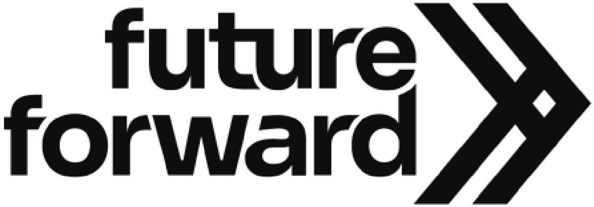

# 04 · Components

Every component here appears in the launch deck. Nothing is speculative. Copy
the markup, change the words.

See them rendered together: `preview/index.html`.

---

## Eyebrow

Mono, uppercase, wide tracking, muted. Names the section above a headline.

```html
<p class="ff-eyebrow">What happens at #ff26</p>
<p class="ff-eyebrow ff-eyebrow--dot">Super early bird — now open</p>
```

The `—` prefix is generated. `--dot` swaps it for an acid bullet, which counts
as your one acid element if you use it.

---

## Highlight marks

The signature move. One per canvas.

```html
<!-- acid highlight on a light background -->
<h1 class="ff-display ff-display--sm"><span class="ff-mark">Get the launch deal:</span></h1>

<!-- black bar over bright photography -->
<div class="ff-mark-lines ff-stack ff-stack--xs">
  <div><span class="ff-display ff-display--sm ff-mark-ink">We're back!</span></div>
  <div><span class="ff-display ff-display--sm ff-mark-ink">Get your ticket to the future.</span></div>
</div>

<!-- white bar over dark photography -->
<span class="ff-display ff-display--lg ff-mark-white">Learn to navigate it:</span>
```

`.ff-mark-lines` on a wrapper makes each child line shrink-to-fit, so the bars
step in and out with the text instead of forming one rectangle. Without it,
multi-line marks run to the full container width.

---

## Meta bar

The recurring date + venue strip. Four variants — pick whichever reads on the
background behind it.

```html
<span class="ff-metabar">26.11.2026&nbsp;|&nbsp;weXelerate, Praterstrasse 1, 1020 Vienna</span>
<span class="ff-metabar ff-metabar--ink">…</span>    <!-- black, on bright photos -->
<span class="ff-metabar ff-metabar--white">…</span>  <!-- white, on dark photos -->
<span class="ff-metabar ff-metabar--bare">…</span>   <!-- no fill -->
```

Add `--bold` for the launch/announcement register. Convention: the meta bar
appears on the first and last slide of a carousel.

---

## Buttons and the next-pill

```html
<a class="ff-btn"><span class="ff-btn__arrow">→</span> Get your ticket</a>
<a class="ff-btn ff-btn--ink">Register now</a>
<a class="ff-btn ff-btn--ghost ff-btn--sm">See programme</a>
<a class="ff-btn ff-btn--block">Get ticket →</a>
<span class="ff-next">→</span>
```

`.ff-next` is the outlined arrow pill that sits bottom-right on every carousel
slide except the last. It is a reading cue, not a button — the last slide gets
the real CTA instead.

---

## List rows

Agenda, programme, anything enumerable. Six rows maximum; past that, split
across two slides.

```html
<div class="ff-list">
  <div class="ff-list-row">
    <div class="ff-list-row__icon">→</div>
    <div>
      <div class="ff-list-row__label">Coffee Rave</div>
      <div class="ff-list-row__desc">An energetic morning opener.</div>
    </div>
  </div>
</div>
```

`.ff-list-row--accent` fills a row with acid — use it to mark one item as new.
`.ff-list-row--flat` removes the surface fill for a lighter, rule-less list.

The icon slot takes a character or an inline `<svg>`. Keep them monoline and
neutral; this is not an illustrated brand.

---

## Stat cards

Numbers are always mono. That is what makes them read as measurement.

```html
<div class="ff-stats">
  <div class="ff-stat">
    <div class="ff-stat__value">899</div>
    <div class="ff-stat__label">Attendees</div>
    <div class="ff-stat__note">With a golden ratio of CEOs and founders</div>
  </div>
  …
</div>
```

`.ff-stats` is a three-column grid; `.ff-stats--2` for two. Six tiles is the
ceiling on a 4:5 canvas. At most one `.ff-stat--accent`.

## Fact tiles

Centred, smaller, for a date-and-number row rather than a proof block.

```html
<div class="ff-grid ff-grid--3">
  <div class="ff-fact">
    <div class="ff-fact__over">Thursday</div>
    <div class="ff-fact__value">26.11.</div>
    <div class="ff-fact__under">Vienna · 2026</div>
  </div>
</div>
```

---

## Comparison table

Pain on the left (muted), outcome on the right (ink, acid header).

```html
<div class="ff-compare">
  <div class="ff-compare__cell ff-compare__head">Before</div>
  <div class="ff-compare__cell ff-compare__head ff-compare__head--after">After</div>

  <div class="ff-compare__cell">Navigating<br>uncertainty alone</div>
  <div class="ff-compare__cell">Part of a 1,000-<br>strong network<span class="ff-tick">✓</span></div>
</div>
```

Cells alternate odd/even, so they must come in pairs. Break each cell to two
short lines with `<br>` — the mono face is wide and ragged wrapping looks
accidental. Five rows reads best; seven is the maximum.

---

## Bar chart

```html
<div class="ff-bars">
  <div class="ff-bar ff-bar--lead">
    <div class="ff-bar__label">Executives &amp; Founders</div>
    <div class="ff-bar__track"><div class="ff-bar__fill" style="--ff-bar-value: 100%"></div></div>
    <div class="ff-bar__value">40 %</div>
  </div>
</div>
```

`--ff-bar-value` is the bar's width **relative to the largest bar**, not the
raw percentage: the biggest value is 100% and the rest are scaled against it.
Exactly one `.ff-bar--lead` per chart — it gets the acid fill and a bold label,
and it should be the bar the headline is about.

---

## Panel

A bordered callout for a secondary fact.

```html
<div class="ff-panel">
  <div class="ff-panel__title">The golden ratio</div>
  <p class="ff-body ff-body--md ff-body--muted">~31% Startups · ~32% Corporates · ~37% Enablers</p>
</div>
```

## Card

A solid white block that floats over photography.

```html
<div class="ff-card ff-row">
  
  <div>
    <div class="ff-title">Praterstrasse 1</div>
    <div class="ff-body ff-body--sm ff-body--muted">1020 Vienna · Austria</div>
  </div>
</div>
```

Cards are light islands — ordinary type classes inside them read dark
automatically, even on a dark canvas.

---

## Ticket card

```html
<div class="ff-ticket">
  <div class="ff-ticket__flag">Most popular</div>
  <div class="ff-ticket__body">
    <span class="ff-ticket__kicker">Boarding pass</span>
    <div class="ff-ticket__name">Full-day ticket</div>
    <div class="ff-ticket__sub">Complete conference experience</div>
    <div class="ff-rule-dashed"></div>
    <ul class="ff-checklist">
      <li>Full conference access</li>
      <li>Afterparty access</li>
    </ul>
    <a class="ff-btn ff-btn--block ff-btn--sm ff-u-mt-8">Get ticket →</a>
  </div>
</div>
```

The 2px black border and dashed rule are deliberate: it should read as a
printed pass, not a pricing table. `.ff-ticket__flag--acid` swaps the black
banner for acid.

---

## Step list

Three display words knocked out of white bars, each with a rule leading in.
Photo slides only.

```html
<div class="ff-steps">
  <div class="ff-step">
    <div class="ff-step__arrow">⟶</div>
    <div>
      <div class="ff-step__word">Connect</div>
      <div class="ff-step__desc">Cross-industry leaders from 42+ nations — all in one room.</div>
    </div>
  </div>
</div>
```

Three steps. Not two, not four — the rhythm is the point.

---

## Sticker

The brand's only informal voice. A rotated white circle with mono text and an
acid highlight.

```html
<div class="ff-sticker">
  <span>Don't miss the</span>
  <span><mark>launch&nbsp;day</mark></span>
  <span><mark>ticket&nbsp;deal</mark></span>
  <span>until May 28!</span>
</div>
```

**At most one per carousel.** It is a wink. Two stickers is a different brand.

---

## Logo, lockup and footer

```html


<div class="ff-lockup">
  <span class="ff-lockup__kicker">the yearly<br>flagship event by</span>
  
</div>

<div class="ff-footer">
  <span></span>
  
  <span class="ff-next">→</span>
</div>
```

`.ff-footer` is a three-column grid (start / centre / end). Pass an empty
`<span>` for a slot you don't need so the centre stays centred.

Sizes: `--sm` 42px, default 58px, `--lg` 104px, `--hero` 190px.

---

## Layout helpers

| Class | Does |
|---|---|
| `.ff-pad` | Page margin + flex column |
| `.ff-stack` `--xs/--sm/--md/--lg/--xl` | Vertical gap between children |
| `.ff-row` `--between/--end/--top/--baseline` | Horizontal flex |
| `.ff-grid` `--2/--3` | Equal-column grid |
| `.ff-spacer` | Pushes what follows to the bottom |
| `.ff-figure` `--square/--4x3/--16x9/--3x2` | Cropped photo block |
| `.ff-bleed` / `.ff-scrim` / `.ff-on-photo` | Photo layering |
